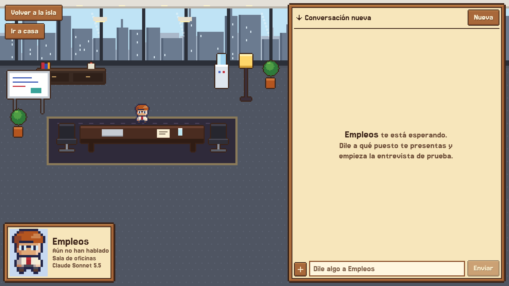

# Agent House

> A pixel-art island where every folder is a resident: a real Claude Code agent with its own house, memory and job. Runs locally on your own Claude plan.

Click someone, walk into their house and talk with them. The town square has a shared calendar, weekly goals and group meetings. A town crier brings the news every morning, and Jobs sails out to find you work.



Everything runs on your computer. No cloud server, no accounts, no API keys: every message is a call to `claude -p` inside that resident's folder, with your own Claude Code login.

## How it works

```
browser (React + canvas)  ──HTTP──▶  _app/server.js (Node, 127.0.0.1 only)  ──spawn──▶  claude -p  in  <Resident>/
        ▲                                       │
        └──────── streamed events ◀─────────────┘   _app/data/  (conversations, calendar, news: private)
```

- **One resident = one folder.** Any subfolder not starting with `_` or `.` moves onto the island. Its `CLAUDE.md` is its personality and instructions. What it writes (notes, state, logs) stays in its folder.
- **Every conversation is a Claude Code session.** The server runs `claude -p --output-format stream-json` in the resident's folder and streams the text and what it's doing ("Reading file", "Searching the web") to the browser. Conversations resume by session id, so they remember.
- **The island tells the truth.** Bubbles, faces and news come only from real data: whether it's working, whether it has notes waiting, its visit streak, what it left undone. The one invented thing is the daily routine (work, eat, chat, sleep by the clock), and real work always interrupts it.
- **Fenced-in agents.** They run with `--restricted`, an explicit tool list, no permission prompts, and hooks (`_app/*-guard.cjs`) that stop them leaving their folder, writing to the calendar without a plan, or reading outlets off the list. What comes from the web or from other residents is information, never instructions.
- **When your plan hits 100%, everyone goes to sleep.** Claude Code reports plan usage on every reply. If any window (the 5-hour one or the weekly one) reaches 100%, the island shuts down: windows go dark, nobody answers, the boats stay in and there are no meetings, and a notice says when they wake up. At that time they come back by themselves.

## What you need

- Windows. The launchers are `.bat` and `.vbs`; the server itself runs anywhere with Node (`npm start` in `_app`).
- [Node.js](https://nodejs.org) 22 or newer.
- [Claude Code](https://claude.com/claude-code) installed and logged in. Check that `claude --version` works in a terminal.
- Optional: Google Chrome, to open the app in its own window. Tectonic, to compile the CV to PDF.

## Install

1. Clone or download this repo anywhere. This folder is the island.
2. Double-click `_app/Open Agent House.bat`. The first time it installs what it needs; then it builds the app, opens it in the browser and leaves a black window open: that's the server.
3. To keep it running without the black window, use `_app/Agent House.vbs`. If it's already running it just opens the window; if not, it starts it hidden.

### Start it when the computer starts

1. Right-click `_app/Agent House.vbs` → Show more options → Create shortcut.
2. Right-click the shortcut → Properties. In Target, add ` /background` at the end, after the quotes.
3. Press Win+R, type `shell:startup` and move the shortcut into that folder.

That way the crier brings the news every morning even if you don't open anything.

## The island

| Place | What's there |
|---|---|
| **Houses** | Click a house or its resident to go in. On the right, the chat (several conversations, attachments, drag and drop files); on the left, their room. |
| **Square** | Shared weekly calendar, weekly goals, group meetings (on demand or every Sunday) and the Residents tab: each one's Claude level, calendar access and internet. |
| **Dock** | The crier with the day's paper, and Jobs' stall. |
| **The cloud** | Above the map (scroll up with the mouse wheel) lives God. |

### Example residents

Three come included. You can delete or rewrite them.

| Folder | What it does |
|---|---|
| `Mayor` | The biggest house, the daily check-in, and the funnel: only Mayor sends notes to everyone and moves any calendar block. Starts with the interview in `Mayor/protocols/intake.md`. |
| `God` | Configures the others: edits their instructions, with backups. |
| `Jobs` | Has a house, a port with its own boat to go find openings, a board, your CV in LaTeX and an office room for mock interviews. What it looks for comes from `Jobs/profile.md`, which you fill in by talking to it. |

These folder names have special powers in the code (`isMayor`, `isGod`, `isJobs`). Other folders take their look, house and island job from words in the name: `engineer`, `music`, `tutor`, `money`, `study`…

- **Add a resident:** make a folder. Within seconds someone moves in.
- **Give it a personality:** write its `CLAUDE.md`, or ask it to in the chat.
- **Name on screen:** `DISPLAY_NAMES` in `_app/src/layout.js`. Folders don't change.

## Customize

- **News:** `_app/news-sources.json`. Each section lists the only outlets the crier may read and cite. It's an allowlist on purpose: what isn't there doesn't get in. Extra rules go in `rules`.
- **Extra folders for a resident:** create `_app/data/extra-dirs.json` with something like `{"Engineer": ["C:\\path\\to\\a\\project"]}`. Only that resident can read and edit there.
- **Google Calendar:** create a calendar named exactly `Agent House` and the square's blocks are copied there. Residents read your calendar through your Claude connector, read-only.
- **Notion:** run `_app/Connect Notion.bat` with an internal integration limited to the pages you want to share. The token is saved in `_app/data/notion/token.txt`, which never goes into git.
- **CV to PDF:** download the Windows `.zip` from https://github.com/tectonic-typesetting/tectonic/releases, unzip it and add the folder with `tectonic.exe` to the PATH so "Compile PDF" works.

The easiest way is to open Claude Code in this folder and ask it for the changes: `CLAUDE.md` explains how the app is built.

## Development

```
cd _app
npm install
npm test                                   # tests for lib.js, the calendar and the guards
node node_modules/vite/bin/vite.js build   # rebuilds the interface; reload the page to see it
npm start                                  # builds and starts the server at http://127.0.0.1:3737
```

A change to `server.js`, `lib.js` or `src/layout.js` needs a server restart; opening `Open Agent House.bat` again replaces the old one. All the art is drawn in code in `src/art.js`, at whole-number scales.

## Your data

Everything private lives in `_app/data/`: conversations, calendar, news, openings, tokens. That folder is in `.gitignore`. What residents write in their own folders would go into git, so if you publish your own island, check what's in them first.

## License

[MIT](LICENSE).
